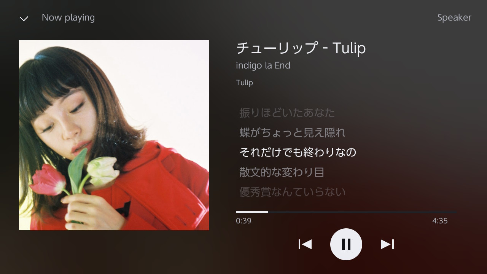
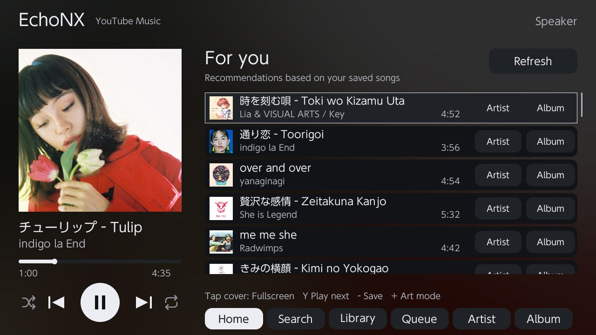

# EchoNX

**Listen to YouTube Music on your Nintendo Switch, directly over Wi-Fi. No PC or phone companion required.**

EchoNX is a native homebrew music player for Switch consoles running custom firmware. Search for a song, build your library, and listen with artwork and lyrics in a fullscreen player.

<p align="center">
  
</p>

## Features

- **Standalone streaming:** music plays directly on the Switch over Wi-Fi.
- **Search and browse:** find songs and open artist or album pages.
- **Your library:** save songs to the SD card and get recommendations based on your saved tracks.
- **Fullscreen player:** blurred artwork background, scrolling titles, and touch playback controls.
- **Lyrics:** animated synced lyrics, plus touch scrolling for lyrics without timestamps.
- **Touch and controller navigation:** swipe lists, or select songs with directional buttons and either analog stick.
- **Playback controls:** queue, pause, previous/next, and tap-to-seek.
- **Backlight off:** keep listening with the screen dark while EchoNX stays open.
- **Audio output indicator:** see whether audio is routed to speakers, a headset, or another output.

## What you need

- A Nintendo Switch with custom firmware.
- An SD card and a working Wi-Fi connection.
- The `echonx.nro` application file.

## Quick start

1. Copy `echonx.nro` to `sd:/switch/echonx/echonx.nro`.
2. Connect your Switch to Wi-Fi and launch EchoNX through Homebrew Menu.
3. Press **X** to search, select a song, and press **A** to play.
4. Press **−** to save the current song. Tap its cover to open the fullscreen player.

Your saved library lives at `sd:/switch/echonx/library.json`.

## Good to know

- **No Google sign-in:** recommendations use your locally saved songs, rather than your YouTube Music account history.
- **Screen off means backlight off:** it is not Switch sleep mode. Playback stays inside EchoNX and does not run over other games.
- **Lyrics and album details vary:** some songs have synced lyrics, some have plain lyrics, and others have none.
- **Still in development:** service changes and network interruptions can affect playback. Artwork cache limits and streaming retries are implemented, but long-session stability still needs device testing.

## Screenshots

| Main screen | Fullscreen player |
| --- | --- |
|  |  |

## Controls

| Input | Action |
| --- | --- |
| A | Play the selected song; in fullscreen, play/pause |
| B | Leave fullscreen or return to Home |
| X | Search for a song or artist |
| Y | Play/pause |
| Up/down or either analog stick | Move the song selection |
| L / R | Switch tabs |
| ZL / ZR | Previous / next song |
| − | Save or remove the current song from your library |
| + | Turn off the backlight during active playback |
| Right stick click | Exit the app |
| Left stick click | Open the artist page |

**Touchscreen:** swipe the song list or plain lyrics, tap the progress bar to seek, and tap the cover to enter or leave fullscreen. In fullscreen, tap the artist or album name to open its page.

After turning off the backlight, press a button or touch the screen to bring it back.

## Building from source

EchoNX uses C++, libnx, SDL2, SDL2_ttf, SDL2_image, FFmpeg, curl, and mbedTLS. The included build script runs in Docker using `devkitpro/devkita64`.

**A Docker portlibs volume containing FFmpeg built for Switch is required.** The script does not build FFmpeg from scratch; the standard devkitPro image alone is not enough.

From PowerShell in the repository directory:

```powershell
powershell -ExecutionPolicy Bypass -File .\Build.ps1
```

The default portlibs volume is `switch-music-portlibs`. To use another volume:

```powershell
.\Build.ps1 -PortlibsVolume your-volume-name
```

The application is written to `build-switch/echonx.nro`. Build output is logged in `build.log`.

## Project layout

| Path | Contents |
| --- | --- |
| `src/` | Application interface, service requests, and audio playback |
| `include/` | Song models, library storage, recommendations, lyrics, and UI helpers |
| `romfs/` | Certificate bundle used for HTTPS |
| `vendor/` | Bundled JSON dependency |
| `tests/` | Library persistence and visual helper tests |

The host tests can be configured independently with CMake from `tests/`. They cover library replacement and recovery, icon geometry, edge smoothing, and UI helper logic. They do not replace playback testing on a Switch.

## Credits

- **Echo Music** — visual inspiration for the player.
- **devkitPro and libnx** — Switch toolchain and system APIs.
- **SDL2 and FFmpeg** — interface rendering and audio playback.
- **LRCLIB** — lyric data.
- **curl, mbedTLS, and nlohmann/json** — networking, TLS, and JSON support.

EchoNX is not affiliated with Nintendo, Google, YouTube, or Echo Music.

## AI-assisted development

EchoNX was developed with AI assistance, including help with implementation, debugging, and documentation. AI-generated code may contain mistakes; testing and review are ongoing.

## License

**GPL-3.0**. See [LICENSE](LICENSE). Third-party components retain their respective licenses.
